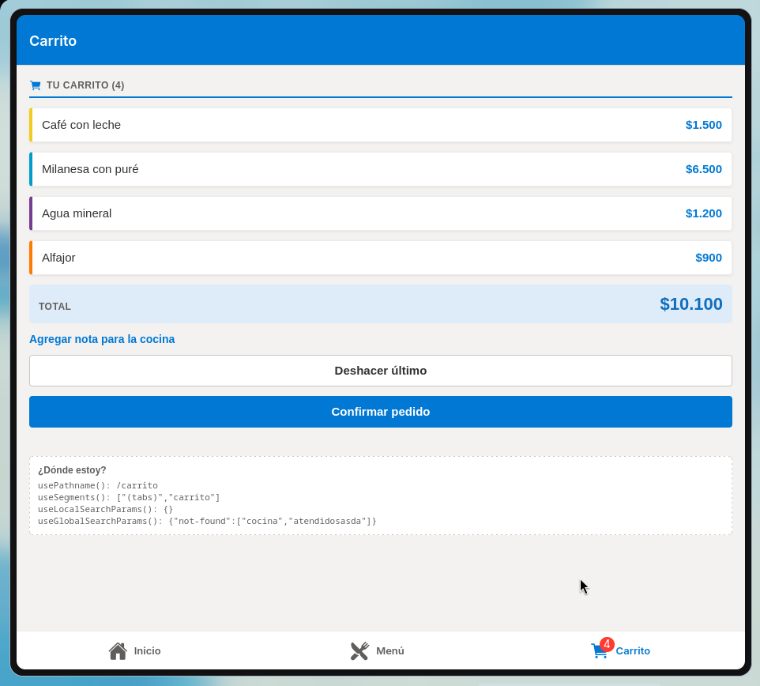
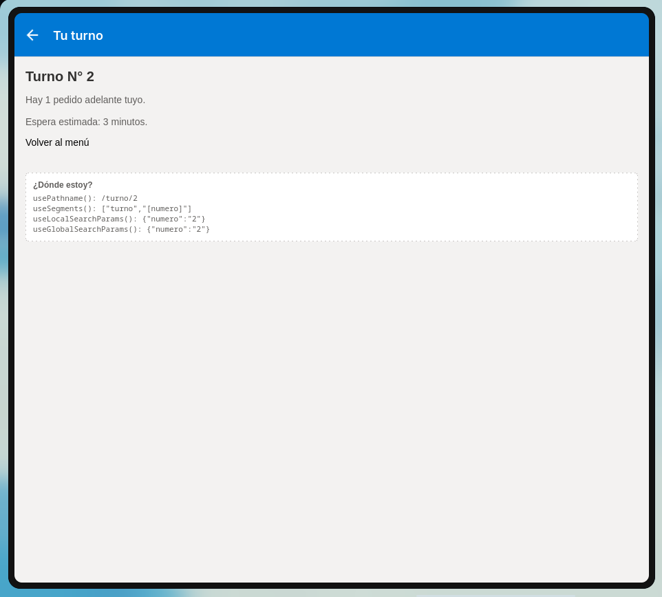
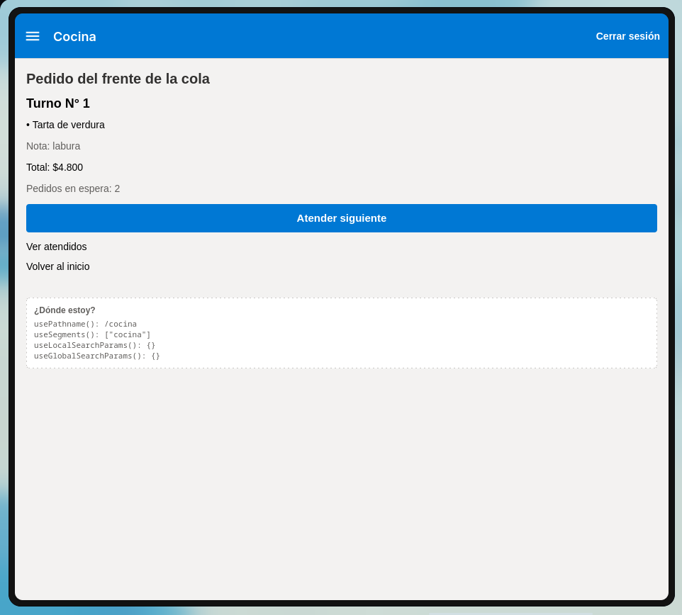
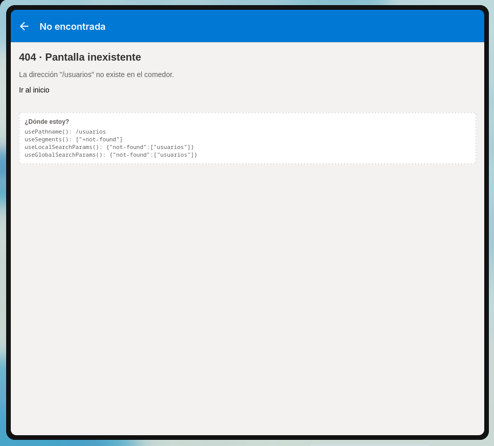
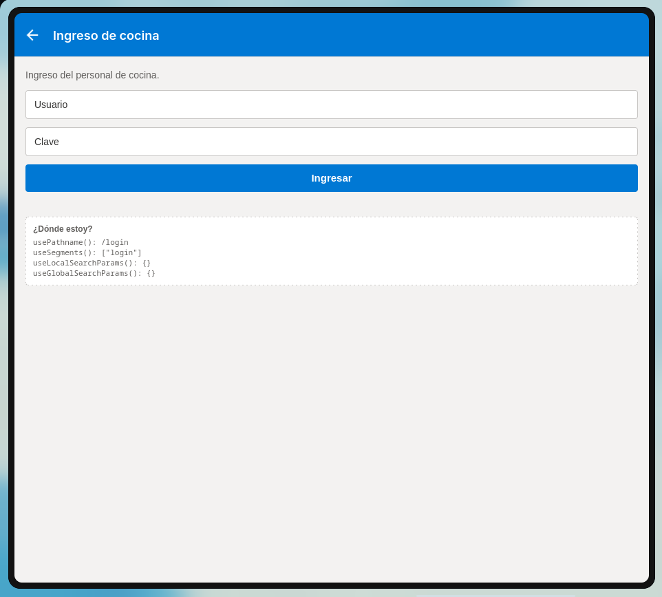

# Comedor IPF

App del comedor del Instituto Politécnico Formosa hecha con **Expo Router (SDK 57)** y TypeScript.
Los alumnos piden desde el celular y la cocina atiende **en orden de llegada** (una **Cola**); el carrito
tiene "Deshacer último" (una **Pila**) y la cocina guarda el historial de atendidos (otra **Pila**).

## Cómo correrla

```bash
npm install
npx expo start
```

- Credenciales de cocina (fijas en `src/context/ComedorContext.tsx`): usuario `cocina`, clave `ipf2024`.
- Paquetes agregados siempre con `npx expo install` (`@expo/vector-icons`).

## Árbol de carpetas

```
src/
├── app/                                  ← SOLO rutas
│   ├── _layout.tsx                       Stack RAÍZ + Providers + Stack.Protected + GestureHandlerRootView
│   ├── +not-found.tsx                    404 (muestra la URL inexistente)
│   ├── pedido.tsx                        /pedido → <Redirect href="/carrito" />
│   ├── (tabs)/
│   │   ├── _layout.tsx                   TABS (expo-router/js-tabs): Inicio · Menú · Carrito (badge)
│   │   ├── index.tsx                     /                 (tab Inicio)
│   │   ├── menu/
│   │   │   ├── _layout.tsx               STACK propio de la tab Menú
│   │   │   ├── index.tsx                 /menu
│   │   │   └── [id].tsx                  /menu/[id]
│   │   └── carrito/
│   │       ├── _layout.tsx               STACK propio de la tab Carrito (nota = formSheet)
│   │       ├── index.tsx                 /carrito
│   │       └── nota.tsx                  /carrito/nota
│   ├── categorias/[categoria].tsx        /categorias/[categoria]   (Stack raíz)
│   ├── buscar.tsx                        /buscar?q=&categoria=     (Stack raíz)
│   ├── confirmar.tsx                     /confirmar                (Stack raíz, modal)
│   ├── turno/[numero].tsx                /turno/[numero]           (Stack raíz)
│   ├── login.tsx                         /login                    (modal, solo SIN sesión)
│   ├── cocina/
│   │   ├── _layout.tsx                   DRAWER (expo-router/drawer), solo CON sesión
│   │   ├── index.tsx                     /cocina
│   │   └── atendidos.tsx                 /cocina/atendidos
│   └── ayuda/
│       ├── index.tsx                     /ayuda (índice)
│       └── [...slug].tsx                 /ayuda/pagos/efectivo, /ayuda/horarios, … (catch-all)
├── components/    Boton, Pantalla, TarjetaPlato, TarjetaAcceso, DondeEstoy, …
├── context/       ComedorContext.tsx  (sesión, carrito, cola y pilas)
├── data/          platos.ts (12 platos, 4 categorías), ayuda.ts
├── estructuras/   Pila.ts, Cola.ts    (campos privados #items, sin shift())
└── constants/     tema.ts
```

### Navegador de cada `_layout`

| Layout | Navegador | Qué contiene |
|---|---|---|
| `app/_layout.tsx` | **Stack** (raíz) | `(tabs)`, `categorias`, `buscar`, `confirmar` (modal), `turno`, `ayuda`, y protegidas: `cocina` (con sesión) y `login` (sin sesión). `anchor: '(tabs)'` |
| `app/(tabs)/_layout.tsx` | **Tabs** (`expo-router/js-tabs`) | `index`, `menu`, `carrito` |
| `app/(tabs)/menu/_layout.tsx` | **Stack** | `index`, `[id]` |
| `app/(tabs)/carrito/_layout.tsx` | **Stack** | `index`, `nota` (`formSheet`) |
| `app/cocina/_layout.tsx` | **Drawer** (`expo-router/drawer`) | `index`, `atendidos` |

Regla usada: las pantallas que deben **mantener la barra de pestañas** van dentro de una tab (detalle del plato,
nota); las que deben **taparla** o no pertenecen a una sección (confirmar, turno, login, buscar, categorías)
van en el Stack raíz.

## Decisiones de navegación

- **`<Link>`** cuando el usuario *toca algo* (tarjetas, accesos rápidos, ayuda); **`router`** cuando se navega
  *después de una lógica* (confirmar pedido, cancelar, Redirect).
- **De `/confirmar` a `/turno/[numero]` usé `router.replace`.** `replace` reemplaza el modal de confirmación por
  el turno, así que "atrás" desde el turno **no** vuelve a la confirmación. Con `push` la confirmación quedaría
  debajo en la pila: al tocar atrás el usuario vería de nuevo el resumen de un pedido ya confirmado (y el carrito
  vacío) y podría intentar confirmarlo otra vez.
- **Login/logout:** no se navega a mano. `Stack.Protected` quita `login` al iniciar sesión (y el layout raíz abre
  `/cocina`) y quita `cocina` al cerrarla, por lo que la sección desaparece del historial sin `router.back()`.
- **Buscador:** `router.setParams` actualiza la URL de la misma pantalla sin apilar pantallas; la búsqueda se
  puede compartir con un link.
- `/pedido` usa `<Redirect>` hacia `/carrito` (equivale a un `replace`, no apila).
- `typedRoutes` activado: ningún `href` escrito a mano que no exista compila.

## Estructuras de datos

- `Pila<T>` (`push`, `pop`, `tope`, `vacia`, `tamanio`, `aArray`) y `Cola<T>` (`encolar`, `desencolar`, `frente`,
  `vacia`, `tamanio`, `aArray`); campos privados `#items`; la cola guarda el índice del frente (sin `shift()`).
- **Cola de pedidos:** al confirmar, el pedido recibe un número de turno y se **encola**. Cocina muestra el
  `frente()` y "Atender siguiente" **desencola**.
- **Pila de deshacer:** cada plato agregado hace `push` de una acción; "Deshacer último" hace `pop` y quita ese
  plato. Se deshabilita cuando la pila está vacía.
- **Pila de atendidos:** cada pedido atendido se apila; `/cocina/atendidos` lo muestra del tope a la base.
- Todo vive en un Context cuyo provider está en el layout raíz.

## Deep link de prueba

Abre el plato 7 (Agua mineral) directamente:

| Dónde | URL |
|---|---|
| Expo Go en desarrollo | `exp://localhost:8081/--/menu/7` |
| Build propia | `comedoripf://menu/7` |
| Web | `http://localhost:8081/menu/7` |

En Expo Go también sirve: `npx uri-scheme open "exp://localhost:8081/--/menu/7" --android`.
Con `anchor: '(tabs)'`, un deep link a `/categorias/bebidas` deja las pestañas debajo en la pila.

## Capturas

| | |
|---|---|
| **1.** Carrito con varios platos, total y botón "Deshacer último" |  |
| **2.** Turno del pedido confirmado (cuántos hay adelante y espera estimada) |  |
| **3.** Cocina atendiendo: pedido del frente de la cola y "Atender siguiente" |  |
| **4.** Pantalla 404 mostrando la URL inexistente |  |
| **5.** Login de cocina (modal, solo sin sesión) |  |
